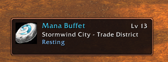

# Partner Panel

*Link up with your favourite person in WoW Forever and see each other at a glance.*

Partner Panel is a small addon for two people who play together: a couple, two best friends, or a veteran and the brand-new player they have somehow talked into all of this. You link up once, and from then on each of you has a little card on your screen that shows where the other one is and how they are doing.

I built it because I am new to World of Warcraft and my partner has been playing for about twenty years, which means a surprising amount of our time together used to go into one question, "where are you?" Partner Panel answers it for us, so we can get back to the part where we actually play.

---

## What it does

### The panel
The panel is a small card you can drag anywhere on your screen, and this little guy takes his job very seriously. He shows you:

- **Your partner's name and level,** in their class colour, with their class on the icon beside it
- **Where they are,** down to the subzone (*Westfall, Sentinel Hill*)
- **What they are up to:** online, AFK, busy, in combat, resting, dead, or a ghost, which is dead with better posture
- **Their health,** as a bar that turns amber at half and red at a quarter, and now keeps going during a fight, which is when you most want it. If WoW Forever keeps their health private mid-fight, the bar politely steps aside instead, exactly as it used to.
- **Where you last saw them,** once they log off or go out of reach (*Last seen in Westfall, 5m ago*)

### Themes
`/pp theme storm` repaints the card. There are eight, named after the soalverse moods: Coral, Storm, Tempest, Ember, Sunset, Sunlit, Wisteria and Fogbank. Coral is the one you already have, and it stays the default, so nothing changes under you when you update.

### Moods
`/pp mood` leaves a short message on your partner's card, up to 60 characters, and it stays there until you change it. Use it for *"brb, snacks,"* *"come find me,"* or *"I have made a terrible mistake in this cave."*

### Linking
Group up, type `/pp link`, and your partner gets a popup asking whether they would like to link with you. It is a very polite popup. If the two of you are Battle.net friends, you do not need the group at all, and `/pp link First Last` reaches them wherever they happen to be standing. Your link is remembered after that, grouped or not, and the card goes live on its own (more on that in [Your link and the live connection](#your-link-and-the-live-connection)).

### Demo mode
If your partner has not installed it yet, `/pp demo` shows a pretend partner, a level 12 paladin who wanders from Goldshire to Duskwood, dies there roughly every twenty seconds, and against all odds gains a level each time. It lets you see the card working on your own.

---

## Getting started

1. **Both of you** install Partner Panel.
2. **Group up** with each other, or be Battle.net friends.
3. One of you types **`/pp link`**, and the other clicks **Accept**. Outside a group, type their whole name, **`/pp link First Last`**.

The card appears near the top left of your screen. Drag it wherever you like, then type `/pp lock` to keep it there.

---

## Your link and the live connection

These are two different parts of Partner Panel, and neither of them needs you to stay in a group.

**Your link is remembered all the time.** Once you have linked, Partner Panel saves it for that character, and it stays saved whether you are grouped or not, through logging out, and through restarting the game. The card stays on your screen with your partner's name on it, and you only need to link again if one of you types `/pp unlink`.

**Live updates follow you out of the group.** Your partner's zone, status, health and mood keep changing on your card for as long as your two copies of Partner Panel can reach each other. While you are grouped, they talk over the group channel, which is the shortest and surest road. When you leave the group, Battle.net quietly takes over, so one of you can be off in a raid with other people and the other can still see where they are and what their mood says. There is nothing new to type and nothing to set up, as long as the two of you are Battle.net friends and you are both logged into WoW.

**When neither road is open,** which is to say you are not grouped, and you are not Battle.net friends, or they have simply logged off, the card keeps the last update it heard, *Last seen in Westfall, 5m ago*, a bit like a photo on the fridge, and says *Offline, or out of reach*. It reconnects on its own within a few seconds of you grouping up, or of them coming back online.

**Linking by name is for when the short version cannot guess.** Plain `/pp link` works out who you mean from your target, or from the one other person in a two-person party. In a bigger party or a raid, it cannot tell which person you mean, so type their whole name instead, `/pp link First Last`. That longer form is also how you link with no group at all, from opposite ends of the world, if the two of you are Battle.net friends.

---

## Commands

| Command | What it does |
| --- | --- |
| `/pp link` | Links you with your partner. With no name, it uses your target, or the one other person in your party. In a bigger group, or with no group at all, type their name: `/pp link First Last`. |
| `/pp unlink` | Undoes the link |
| `/pp mood <text>` | Sets the short message your partner sees. `/pp mood` on its own clears it. |
| `/pp show` and `/pp hide` | Shows or hides the card |
| `/pp lock` and `/pp unlock` | Pins the card in place, or lets you drag it again |
| `/pp theme <name>` | Repaints the card. Coral, Storm, Tempest, Ember, Sunset, Sunlit, Wisteria or Fogbank. `/pp theme` on its own lists them. |
| `/pp reset` | Puts the card back in its starting spot |
| `/pp demo` | Shows the card with a pretend partner |
| `/pp status` | Shows the connection details, including which road your messages are taking, for when something is not working |
| `/pp` | Lists every command |

`/pp` is the short way in, and `/partner` and `/partnerpanel` both still work, for anyone who enjoys typing.

---

## How it works

Your copy of Partner Panel and your partner's copy send each other small, hidden addon messages, so you can see how they are doing and they can see how you are doing.

- **Messages take the best road open to them.** While your partner is in your group, the two copies talk over the group channel, which is the one road addon messages are known to travel on WoW Forever. When you are not grouped, they talk over Battle.net, which carries addon messages between friends wherever they are in the world. Addon whispers between players do not currently arrive on Forever, so they sit last in the queue, still tried in case Blizzard ever lets them through. `/pp status` tells you which road is in use.
- **Only your partner reads your messages.** Each one is addressed to them by name, and anyone else in the group running Partner Panel quietly ignores it. The Battle.net ones only ever go to your partner's account, and to nobody else on your friends list.
- **This is everything it shares:** your level, class, zone and subzone, your status (AFK, in combat, dead, and so on), your health as a percentage, and your mood. Never a number, never a location finer than your subzone.
- **Nothing leaves the game.** There are no websites, no accounts, no tracking, and nothing to sign up for. Your link and settings live in your own WoW folder, one character at a time.
- **It waits its turn in combat.** WoW sometimes holds addon messages at the door during a fight. Partner Panel waits, and everything goes through once the fight is over, without flooding your chat.

---

## Who it is for

- **A new player and a veteran.** The veteran can see where the new player is, and whether they are in trouble, without asking every five minutes.
- **Couples and duos levelling together,** even when you are questing in different corners of the same zone.
- **Keeping each other company** while you each run your own errands in the same group, whether that is fishing, crafting, farming, or staring at the auction house.

---

## What is coming next

Partner Panel is very new, and it has plans.

- **"Should I keep this?":** shift-click an item to ask your partner about it. They answer Equip, Sell, Keep, or Bank, and their answer stays on the item's tooltip, so nobody has to ask about the same grey sword twice.
- **"Come here" ping:** your partner drops a waypoint, and an arrow on your map and screen points you to it.
- **Adventure journal:** it quietly remembers your firsts together, your first dungeon, your first boss, every new zone, with timestamps and screenshots. A small scrapbook of the two of you.
- **Tip cards:** your partner writes tips ahead of time, and they appear for you at the right moment, when you walk into a zone or a dungeon, or reach a certain level. It is like having them on your shoulder, even when they are off making dinner.

---

## Good to know

- Both of you need Partner Panel installed.
- Your link is saved all the time, and live updates follow you out of the group as long as the two of you are Battle.net friends and both logged into WoW. Without Battle.net between you, the card goes quiet until you are grouped again.
- Links are per character, so link again on each character you play together.

---

## Feedback

If something breaks, or you have an idea, open an issue on [GitHub](https://github.com/soalverse/PartnerPanel/issues). If there is an error, the text from [BugSack](https://www.curseforge.com/wow/addons/bugsack) helps me find the problem much faster.

Partner Panel is free and always will be. If you would like to buy me a coffee anyway, there is a [Ko-fi](https://ko-fi.com/soalverse), and I will think of you and your partner while I drink it.

Made with care by Soalverse.
